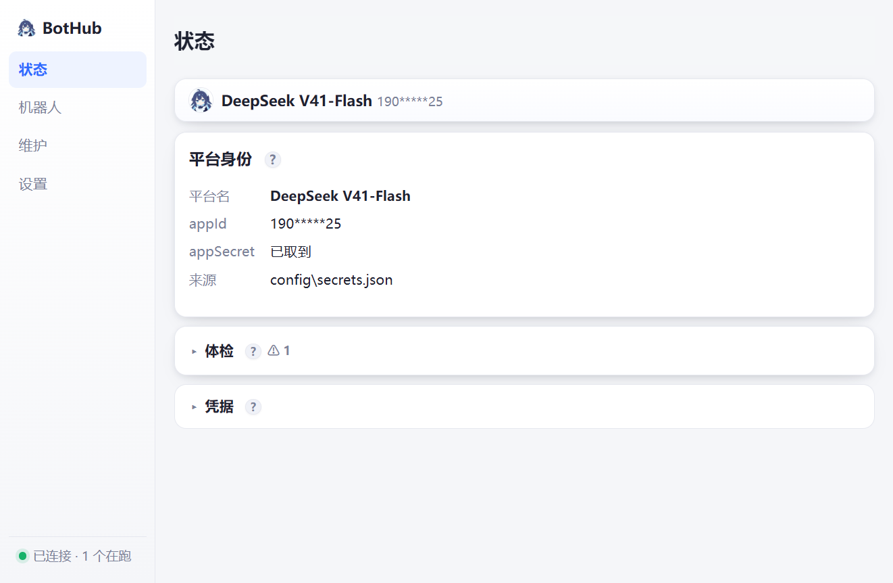

# BotHub

把自己的 QQ 机器人跑在自己电脑上：一个进程带多个机器人，每个机器人可以绑不同的"脑子"。



## 它解决什么问题

QQ 官方机器人 SDK 能用，但**坏了查不出原因**：消息到底有没有推过来、被什么规则挡了、
排队排了多久、网关断线自己有没有接回来 —— 这些在 SDK 里全是黑盒。
BotHub 把这些全部留痕，并且自带体检和恢复演练。

- **全链路留痕**：平台推来（`RAW`）→ 收到（`EVENT`）→ 判定（`QUEUED` / `SKIP … 原因` / `DROP … 原因`）→ 处理 → 回复
- **不会静默丢弃**：限流、去重、队列满、机器人自己发的消息，全部**明确告知**并写明原因
- **坏了能自己回来**：看护进程 5 秒一次按心跳判断，崩了/卡死都拉起来；面板能一键演练"掐断网线"
- **一个进程多个机器人**：每个绑不同的模型通道（云端模型 / DSH 本体 / 本地假通道）

## 怎么用

### 1. 装

1. 装 [Node.js](https://nodejs.org/)（LTS 版就行；如果没装，`install.cmd` 会自己下载一份便携版到 `runtime\node`）
2. 下载本仓库（绿色 **Code → Download ZIP**，或 `git clone`）
3. 双击 **`install.cmd`**
4. 按提示填两样东西：
   - **QQ 机器人的 appId 和 appSecret**（在 [QQ 开放平台](https://bot.q.qq.com/) → 你的机器人 → 开发设置 里）
   - 机器人用哪个"脑子"：**连 DSH**（会读文件、跑命令，推荐）或**任意 OpenAI 兼容的云端模型**（只会聊天）

`install.cmd` 会**先拿这对凭据真去换一次 token**：换不到就不写配置、并告诉你去哪核对。
明文只写进 `config\secrets.json`，`config\bots.json` 里只有引用。

### 2. 用

双击 **`start.cmd`**：它**在后台把程序跑起来，不弹任何窗口**（连黑框控制台都没有），
右下角会出现一个托盘图标。**要看面板就右键那个托盘图标 →「打开面板」**。

打开后是 http://127.0.0.1:7788/ ：

- 顶上一条状态：「机器人在线」+ 头像和名字（从平台读的）
- 每个机器人一张卡：收到几条、回了几条、最后什么时候；`重启` / `断开重连（测试）` / `看日志`
- 两个折叠区：`详细信息`（队列、网关、进程数）、`设置`（换模型、改人格、改限流、**自定义指令**、**填 appId/appSecret**）

然后到 QQ 里**私聊它**，或者**在群里 @ 它**，发一句 `/帮助` 试试。

> ⚠️ QQ 官方机器人**不能主动给你发消息**（平台限制，错误码 40034105），必须你先说话。

### 3. 出问题

双击 **`check.cmd`**：一屏中文体检，每项都写"怎么办"。

**看不到面板窗口了？** 双击 `start.cmd` 之后本来就不会弹窗口（这是故意的）：
右下角托盘图标 → 右键 →「**打开面板**」。托盘图标找不到就点一下任务栏的 `^`（隐藏图标区）。

**屏幕上多了一块没有标题的白色空窗口？** 那不是 BotHub 的界面（BotHub 只有
「标题带 BotHub 的窗口」和右下角托盘图标）。双击 `白窗口-关掉.cmd` 就能清掉；
要是它老回来，双击 `白窗口-盯梢.cmd` 挂着，它一出现就记下是谁干的。

## 自定义指令

在面板「设置」里给每个机器人加指令，发 `/帮助` 就能看到当前这套。四种动作：

| 动作 | 效果 |
|---|---|
| 回固定话 | 你发指令，它原样回你写的那段 |
| 问模型（带提示词） | 指令后面跟的内容，按你写的提示词交给模型 |
| 报状态 | 它报自己：收到几条、队列、最后错误 |
| 重启自己 | 它自己重启，几秒后回来 |

## 两种"脑子"

| kind | 是什么 | 说明 |
|---|---|---|
| `dsh` | 连 [DeepSeek Harness](https://github.com/) 本体 | **会干活**：能读文件、跑命令、用技能；每个对话对象一个会话 |
| `openai` | 任意 OpenAI 兼容接口 | 会聊天，不会干活；1~3 秒 |
| `echo` | 本地假通道 | 不联网，用来验证链路 |

`config\bots.json` 长这样（`install.cmd` 会替你写好）：

```jsonc
{
  "http": { "port": 7788, "host": "127.0.0.1" },
  "channels": [
    { "id": "dsh-local", "kind": "dsh", "profile": "headless", "timeoutMs": 180000,
      "dshExe": "C:\\Program Files\\DeepSeek Harness\\DeepSeek Harness.exe" }
  ],
  "bots": [
    { "id": "qq-main", "alias": "我的机器人", "platform": "qq", "channel": "dsh-local",
      "credentials": { "appId": "${SECRET:qq-main.appId}", "appSecret": "${SECRET:qq-main.appSecret}" },
      "mentionRequired": true, "persona": "……" }
  ]
}
```

密钥只写引用，三种都行：`${ENV:变量名}` / `${FILE:文件路径}` / `${SECRET:键名}`（后者就是面板里填的那种）。
**同一个 appId 不能挂两个进程**（会互相抢事件、表现成时好时坏），配置里会直接拦住。

## 选模型（跟 DSH 里一样）

每个机器人都能单独选模型 —— 面板「设置」里那一栏 **模型**：

- 下拉里的清单**就是你这台 DSH 能用的模型**：BotHub 让 DSH 把自己的配置打印出来（`--dump-config`），
  从里面读供应商和模型列表。**你装了什么插件、有没有免费模型，这里就有什么**（换台电脑就是那台电脑的清单）。
- 用云端模型通道时，还会去问一下接口的 `/models`（OpenAI 兼容），把返回的模型也列进来。
- **可以下拉选，也可以自己填**（填完保存即可）。留空＝跟随通道默认。
- 「供应商」一般不用填；从下拉里选出来的模型会自动带上它。

选中的模型只作用于**这个机器人**：BotHub 给它单独生成一个 patch 覆盖默认模型，
**不会去改你平时用的 DSH 配置**。

### 模型清单是从哪来的

面板「设置 → 模型」里的下拉，是你这台电脑上 **DSH 能用的模型**：

1. **DSH 自己的清单**：让 DSH 打印组合配置（`--dump-config`），读出 `providers.<供应商>.models[]`；
   **所有 profile 合并**（headless / qqbot / 你自建的那些）。
2. **被 Electron 独占的 profile**（`desktop`）dump 不了 —— 就静态扫它的 patch 文件，至少把默认模型读出来。
3. **云端模型通道**：再问一下接口的 `/models`（OpenAI 兼容），把返回的模型也列进来。

所以：**你装了什么插件、有哪些免费模型，下拉里就有什么**；换台电脑就是那台电脑的清单。
也可以**自己手填**（列表里没有的模型名，填进去就行）。


## 界面

- 左边一列导航，**每个页面都有大标题**（状态 / 机器人 / 维护 / 设置）和一句说明。
- **连接状态在左下角**：那颗小圆点 + 一句话（绿＝已连接、黄＝有需要注意的地方、红＝没在跑）。
- **「重启应用」在设置页里**（改完配置不生效时点它，几秒后自己回来，期间会显示等了多久）。
- **颜色模式**：设置 → 软件 → 颜色模式，可选 **浅色 / 深色 / 跟随 DSH**。
- **字体大小**：设置 → 软件 → 字体大小，可选 **小 / 标准 / 大 / 特大** —— 全站一起变（标题、标签、提示、弹层都跟着缩放）。
  「跟随 DSH」是去读你 DSH 自己的主题设置，所以 DSH 换主题、这边跟着换。选择记在本机。


## 教学引导（第一次打开，三步）

1. **介绍** —— 这个软件是干什么的（一屏看完）。
2. **环境** —— 电脑上要先有 DSH 和一个能用的模型；不想自己配，就下载环境包，
   解压后双击 **DSH环境一键配置.cmd**，它会自动找到 DSH、检查模型通道、报告缺哪些可选插件。
3. **绑定** —— 填 AppID 和 AppSecret（在 q.qq.com 的开发设置里）。保存前会真连一次 QQ，
   连不上就一个字都不写。

以后想再看：**设置 → 重新看一遍教学**。

## DSH环境一键配置.cmd

双击它（在软件根目录）会做三件事，**只做这三件**：

1. 找到本机的 **DSH（DeepSeek Harness）**，把路径写进 `config/local.json` → 之后启动 BotHub 就能自动连上；
2. 检查 DSH 里**有没有可用的模型**（读组合配置里的 providers/models），没有就明确告诉你缺什么；
3. 报告那几个**可选**插件/常驻进程在不在（只报告，不擅自安装 —— 装插件属于改你的 DSH）。

DSH 装在非常规位置时，可以直接告诉它路径：
`DSH环境一键配置.cmd --dsh "C:\Tools\DeepSeek Harness.exe"`

## 第一次打开

软件自带**一个机器人**，默认就用**你这台电脑上的 DSH** 当脑子（自动找，找不到会明确告诉你）。
第一次打开会弹一个向导，三步就完事：

1. 打开 **QQ 开放平台**（手机 QQ 扫码登录）
2. 进 **机器人 → 你的机器人 → 开发设置**
3. 把里面的 **AppID** 和 **AppSecret** 复制进向导，点「保存并连接」

保存前软件会拿它真连一次 QQ 验证，**连不上就一个字都不写**；这两个值只存在这台电脑上
（`config\secrets.json`），不会上传到任何地方。以后想再看一遍：**设置页底部「重新看一遍教学」**。

## 记忆规则（机器人怎么记事）

- **只有你让它开新会话，才会开新会话**（发 `/新会话`）—— 放多久不聊，它都记得住前面聊过什么。
- **每个对话对象只留最近 3 次**会话；每次会话在结束（开新会话 / 关软件）时被**压缩成摘要 + 关键词**。
- 压缩后的会话**平时不占上下文**：只有你**提到那些关键词**时，它才会把那次对话翻出来看一眼 ——
  **看完就放回去**，下次还得再提关键词。
- 想看存了哪几次、关键词是什么：发 `/记忆`。
- 这些记录都在**软件自己的文件夹里**（`data\sessions\`），跟 DSH 的数据无关 ——
  DSH 那边怎么改，都不会让你的机器人失忆。

## 加机器人 / 加凭证

软件自带一个机器人。想再加，到面板「设置」：

- **新增机器人**：填个英文 id、起个显示名，然后选它**连哪个脑子**：
  - **DSH** —— 会干活（读文件、跑命令、用技能），推荐
  - **云端大模型** —— 任何 OpenAI 兼容接口（填地址 / 模型名 / 密钥）
  - **本地模型** —— Ollama、LM Studio 那类本机推理服务（默认 http://127.0.0.1:11434/v1 ）
- **新增凭证**：一个凭证 = 一组 AppID / AppSecret（一个机器人账号）。填完点「保存并验证」，
  软件会先拿它真连一次 QQ，**连不上就一个字都不写**。

**一个凭证最多挂 4 个机器人**。注意一个平台限制：**同一个 AppID 同时只能有一条连接**
（两条连接会互相抢消息，表现就是"时好时坏、有时不理人"）。所以同一个凭证下的机器人
**共用那一条连接**：第一个当"连接者"，其余靠**群/私聊白名单**分流 ——
在它的配置里写上哪个群归它管（groupAllow），那个群的消息就交给它，别的机器人不插手；
没人认领的消息由**默认那个机器人**处理。

想要 4 个**各自独立**的 QQ 机器人（各自有 AppID），就建 4 条凭证、每条挂 1 个 —— 那就是 4 条连接，互不干扰。

> 「高级：直接改配置文件（JSON）」在**维护**页里（那是动底层的活）。

- **一条凭证只能绑一个机器人**（初始机器人自带的凭据只属于它自己）。所以再加一个机器人时，
  先点「+ 新增凭证」建一条新的，别指望两条机器人共用一条。
- 每条凭证右侧有 **删除**：初始（自带）凭据**不给删**；还绑着机器人的凭据也**不给删**
  （会提示你先处理那个机器人）。

## 手机访问（同一个 WiFi 下用手机管理）

同一台路由器下，手机浏览器也能打开这个面板，躺着也能看状态、改配置。

1. 电脑上打开 `config\bots.json`，把 `"http": { "host": ... }` 里的 host 改成 `"0.0.0.0"`（默认是 `127.0.0.1`，只允许本机）；
2. 同一段里加一行 **口令**（随便一串字母数字，自己记住）：
   `"lanToken": "你设的口令"`；
3. 点面板左侧「重启应用」；
4. 手机上输入：`http://电脑的IP:7788/?k=你设的口令`
   （电脑 IP：设置 → 网络和 Internet → WLAN → 属性里的「IPv4 地址」）；
5. 手机第一次连的时候 Windows 会弹「是否允许访问」→ **勾"专用网络"再允许**。

**规矩和安全**：不带 `?k=口令` 的设备一律 403（本机 127.0.0.1 不需要口令）。
口令是明文 HTTP 传的，**家里 WiFi 用没问题，外面的公共网络别开**。
不想开了：把 host 改回 `127.0.0.1` 再重启应用，手机就连不上（本机不受影响）。

## 维护（清理 / 压缩）

面板「维护」区，随时能给这个软件瘦身：

| 按钮 | 干什么 |
|---|---|
| 释放内存 | 让程序主动回收一次内存（垃圾回收）+ 丢掉内部缓存。**不重启进程** |
| 压缩会话 | 对话历史是只追加的（模型只看最近 12 轮，旧的一直堆在磁盘上）；压缩＝旧内容变成一行摘要，文件跟着变小 |
| 清空会话 | 抹掉某个机器人/全部对话历史（不可撤销，会二次确认） |
| 清理日志 | 删掉 7 天前的日志 |
| 清缓存 | 清应用窗口的浏览器缓存（登录态不动） |

维护区**展开时才统计**（目录大小要遍历文件，不跟着 5 秒刷新跑）。

## 文件都是干什么的

```
install.cmd      装（Node + 依赖 + 向导）
start.cmd        开（后台启动 + 托盘图标；面板从托盘菜单打开）
check.cmd        出问题先点这个（体检）
白窗口-关掉.cmd   桌面上出现一块"没标题的白色空窗口"时，双击它（只关这一类窗口）
白窗口-盯梢.cmd   挂 30 分钟，那种白窗口一出现就记下时间和当时启动的进程（写 data\logs）
白窗口-查是谁.cmd 双击后 8 秒内点一下那个窗口，它直接报出是哪个程序（只读，不关东西）
src\             程序本体
  main.mjs       入口、状态汇总、面板接口
  bot.mjs        一个机器人的全部行为（门控、去重、限流、指令、发送）
  queue.mjs      每个对话对象一条队列（忙碌时立刻回执、超时中断、锁一定释放）
  models.mjs     模型通道：openai / dsh / echo
  web.mjs        本机面板的 HTTP 接口
  ui.html        面板界面（改完刷新页面就生效）
  config.mjs     配置校验（坏配置自动回滚）
config\
  bots.json      你的配置（install.cmd 生成；里面没有明文密钥）
  secrets.json   只有密钥（明文在这，别外传）
tools\           看护、体检、向导、托盘
data\            运行数据：日志、心跳、会话
```

## 常见问题

**它不理我** —— 群里要 **@ 它**（默认必须 @），私聊不用。还不行就双击 `check.cmd`。

**能改名字和头像吗** —— 名字和头像在 QQ 开放平台控制台里改，官方接口只提供读取（面板里能看到真实头像和名字，改不了）。

**会不会弹黑窗口** —— 不会。所有后台任务都套了一层隐藏外壳（`tools\run-hidden.vbs`），
因为 Windows 计划任务直接跑 `node.exe` 是会给一个控制台窗口的。

**怎么彻底关掉** —— 托盘右键 →「全部退出（应用 + 看护一起停）」；下次双击 `start.cmd` 就回来。

## 目录外的说明

- 只支持 **Windows**（用了计划任务、托盘、Edge/Chrome 应用窗口）
- 面板只监听 `127.0.0.1`，不对外网开放
- 许可证：MIT（见 `LICENSE`）
